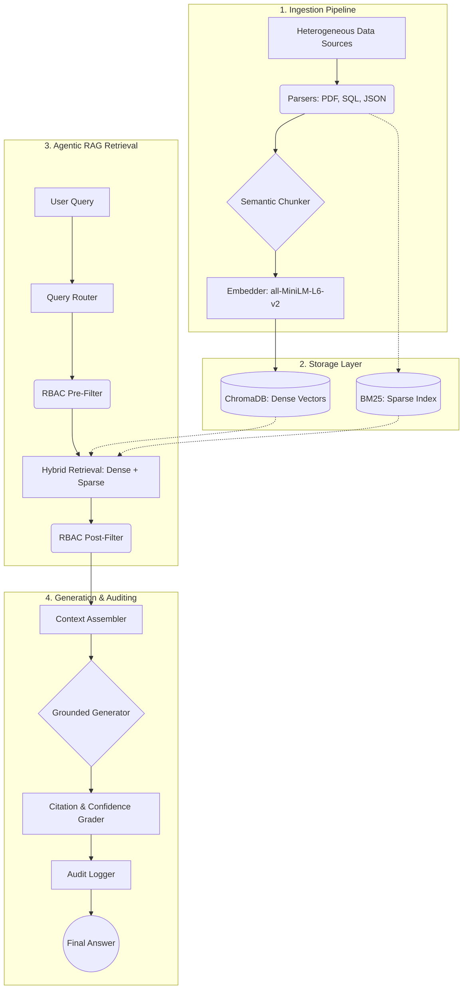

# EnterpriseIQ System Architecture

This document provides a high-level overview of the EnterpriseIQ architecture. For detailed component-level documentation, please refer to the `docs/architecture/` directory.

## Core Philosophy

EnterpriseIQ is designed around three core principles:
1.  **Strict Security & RBAC:** Data access is explicitly verified before *and* after retrieval.
2.  **Zero Hallucination:** The system prioritizes extractive retrieval; if an answer isn't in the context, the system explicitly refuses to answer.
3.  **Offline-First & Graceful Degradation:** The platform operates fully offline via local models (e.g., SentenceTransformers, Llama 3) and falls back to robust algorithms (e.g., deterministic hashing for embeddings) if complex models fail.

## High-Level Architecture

The system operates across three primary stages: Ingestion, Retrieval, and Generation.

## Component Breakdown

1.  **Ingestion:** Documents (PDFs, SQL exports, JSON logs) are parsed, semantically chunked, and embedded using `all-MiniLM-L6-v2`.
2.  **Storage:** A unified vector space (ChromaDB) and sparse index (BM25) store the chunks, enabling Min-Max fused hybrid search.
3.  **Security (RBAC):** Multi-layered filtering ensures that users only retrieve documents matching their department, clearance level, and explicit ACLs.
4.  **Generation:** The `GroundedAnswerGenerator` uses the filtered context to construct an answer, explicitly citing the source chunk (`chunk_id`) and scoring its confidence.
5.  **Observability:** Every query, routing decision, and access control evaluation is logged to the `AuditLogger` and observable via Prometheus/OpenTelemetry.

## Execution Flow

When a request arrives at the `/query` endpoint:
1.  **Authentication:** The API key is validated.
2.  **Routing:** The `QueryRouter` classifies the intent of the query.
3.  **Retrieval:** The `HybridRetriever` fetches candidates from ChromaDB and BM25, dynamically weighting the scores based on `HYBRID_ALPHA`.
4.  **Security Check:** The retrieved candidates are filtered against the user's effective role by the `RBACEngine`.
5.  **Assembly & Generation:** Authorised chunks are passed to the generator to formulate a cited, extractive response.
6.  **Audit:** The entire lifecycle, including denied chunk counts, is written to the audit log.
