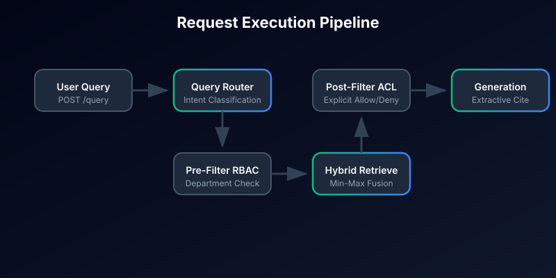

<div align="center">


# EnterpriseIQ

**The production-grade Agentic RAG platform for strictly governed enterprise environments.**

[](https://python.org)
[](https://fastapi.tiangolo.com)
[](https://opensource.org/licenses/MIT)
[](https://github.com/astral-sh/ruff)
[](https://www.docker.com/)

[**Documentation**](./docs/index.md) | [**API Reference**](./docs/api.md) | [**Architecture Deep Dive**](./docs/architecture.md) | [**Security**](./SECURITY.md)

</div>

---

## What is EnterpriseIQ?

Standard RAG (Retrieval-Augmented Generation) pipelines fail in the enterprise because they leak cross-department data and hallucinate facts. **EnterpriseIQ** is built to solve these exact problems. It acts as a bridge between powerful AI capabilities and strict Enterprise Compliance.

EnterpriseIQ treats enterprise knowledge as a strictly governed asset. It fuses vector search with keyword anchoring, enforces multi-layered Role-Based Access Control (RBAC), and demands absolute lexical grounding for every generated answer.

### Core Capabilities

- 🛡️ **Zero-Trust RBAC**: Data access is explicitly verified before *and* after retrieval. Users only retrieve documents matching their department, clearance level, and explicit ACLs.
- 🔍 **Min-Max Hybrid Retrieval**: Combines Dense Vector Search (`all-MiniLM-L6-v2` via ChromaDB) with Sparse Keyword Search (BM25) to perfectly anchor exact identifiers (e.g., `INC-1234`).
- 🛑 **Zero Hallucination Guarantee**: By default, the system operates in "Offline Extractive Mode." It relies purely on retrieved context and explicitly refuses to guess if the answer is missing.
- 📑 **Grounded Citations**: Every claim is backed by a precise citation linking directly to the source document and exact chunk.
- 🔌 **Fully Offline & Resilient**: Operates fully offline. If models fail to load, the system falls back to robust deterministic hashing to maintain availability.

---

## 🏗️ Execution Flow

<div align="center">

</div>

When a query is made, EnterpriseIQ dynamically routes the intent, retrieves candidates via a hybrid index, strictly filters out unauthorized data based on the user's role, and synthezises an explicitly cited answer.

---

## 🚀 Quick Start

Get EnterpriseIQ running locally in under 5 minutes.

### 1. Installation

Requires **Python 3.10+**.

```bash
git clone https://github.com/enterpriseiq/enterprise-knowledge-intelligence-platform.git
cd enterprise-knowledge-intelligence-platform

# Setup virtual environment
python -m venv .venv
source .venv/bin/activate  # On Windows: .venv\Scripts\activate

# Install with development and optional LLM support
pip install -e ".[dev,llm]"
```

### 2. Generate Synthetic Data

EnterpriseIQ ships with a synthetic data generator to create a realistic corporate corpus for testing.

```bash
python -m data.generate_data
```

### 3. Run the API Server

```bash
uvicorn src.api.main:app --reload
```

Visit `http://localhost:8000/docs` to interact with the Swagger UI.

### 4. Query the System

Ask a question simulating the `Finance` role:

```bash
curl -X POST "http://localhost:8000/query" \
     -H "Content-Type: application/json" \
     -d '{"query": "Show me the Q4 budget allocations", "role": "Finance"}'
```

---

## 📂 Project Structure

```text
enterprise-knowledge-intelligence-platform/
├── src/                # Core RAG, RBAC, and FastAPI backend
├── website/            # React/Vite Frontend Interface
├── docs/               # Comprehensive platform documentation
├── data/               # Synthetic corpus and RBAC policies
├── k8s/                # Kubernetes Kustomize manifests
├── helm/               # Helm charts for deployment
└── tests/              # Comprehensive Pytest suite
```

## 📚 Documentation

For deep dives into configuration, architecture, and deployment, please see the official [Documentation](./docs/index.md).

- **[Installation Guide](./docs/installation.md)**
- **[System Architecture](./docs/architecture.md)**
- **[Design Decisions & Trade-offs](./docs/design.md)**
- **[Performance & Scaling](./docs/performance.md)**
- **[Troubleshooting](./docs/troubleshooting.md)**

## 🛡️ Security

Security and data isolation are our primary mandates. Please review our [Security Policy](./SECURITY.md) for threat models and vulnerability reporting guidelines.

## 🤝 Contributing

We welcome contributions from the community! Please read our [Contributing Guidelines](./CONTRIBUTING.md) and our [Code of Conduct](./CODE_OF_CONDUCT.md).

## 📄 License

This project is licensed under the [MIT License](./LICENSE).

## 🙏 Acknowledgements

EnterpriseIQ is built upon the incredible work of the open-source community, particularly [FastAPI](https://fastapi.tiangolo.com/), [ChromaDB](https://www.trychroma.com/), and [SentenceTransformers](https://sbert.net/).
