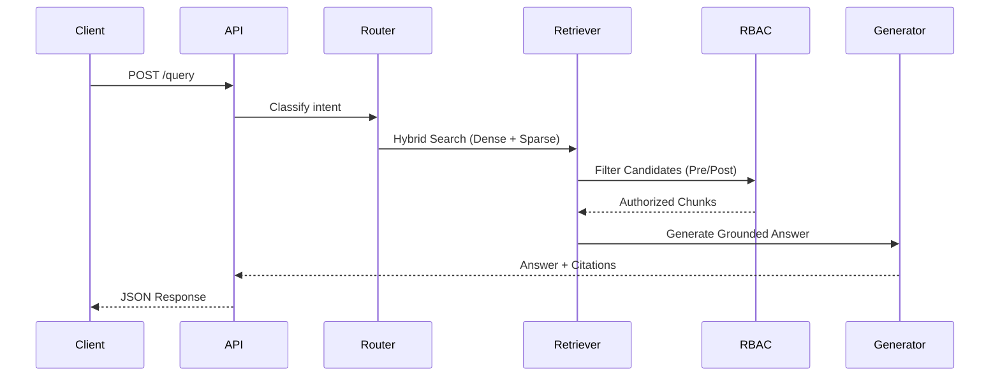

# API Reference

The EnterpriseIQ backend is built on FastAPI. When the server is running, you can access the interactive Swagger UI at `http://localhost:8000/docs`.

## Core Endpoints

### `POST /query`

Executes a secure, RBAC-filtered retrieval and generation pipeline.

**Request Body:**
```json
{
  "query": "Summarize the Q3 financials",
  "role": "Finance",
  "user_id": "user123",
  "top_k": 5
}
```

**Response Flow:**


### `GET /health`

Returns the liveness status and the backend state (ChromaDB, BM25 indices).

### `GET /roles`

Returns the current RBAC configuration, including roles and their clearances.

### `GET /audit`

Returns the recent audit trail, demonstrating which chunks were authorized or denied for a given query.
