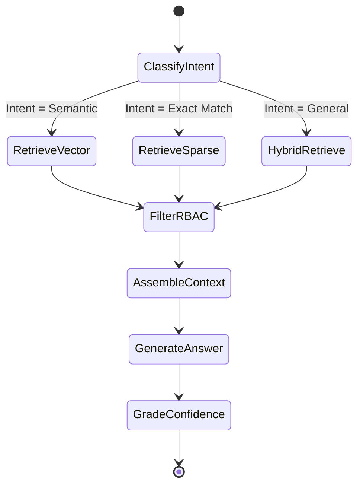
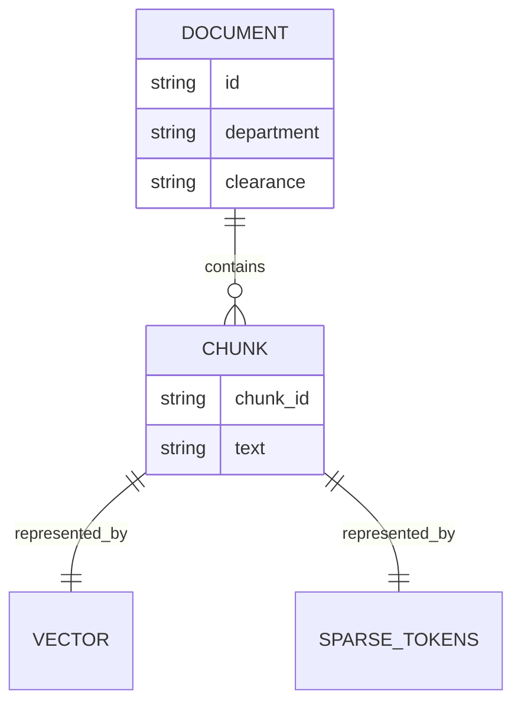

# System Architecture Deep Dive

EnterpriseIQ is designed to be resilient, offline-capable, and highly secure.

## The Agentic RAG Pipeline

Instead of a linear pipeline, EnterpriseIQ uses a LangGraph-based agentic state machine.

## Storage Layer

The storage layer unifies structured and unstructured data into a single semantic space.

For more, see the [Design Decisions](design.md).
