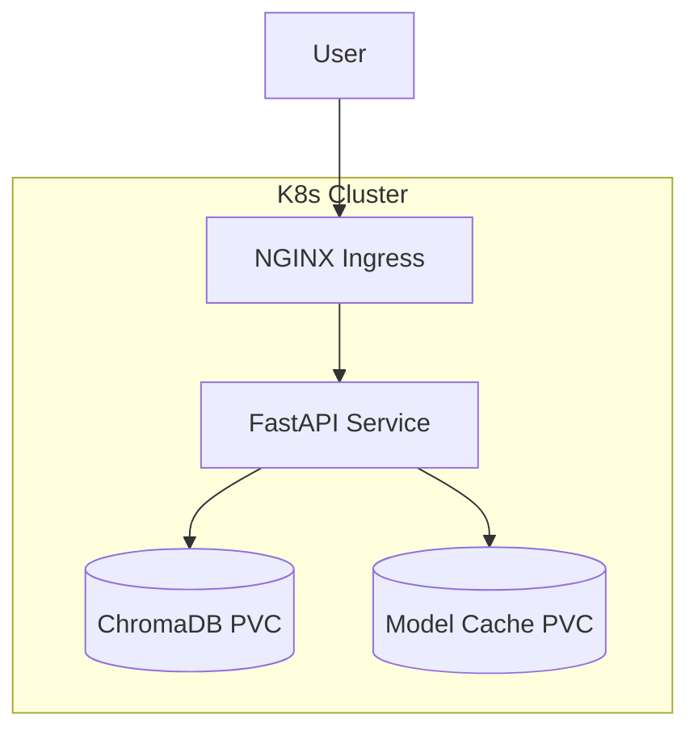

# Deployment Architecture

EnterpriseIQ is designed to be easily deployed to modern cloud infrastructure (e.g., Kubernetes, AWS ECS) using containerization.

## Kubernetes Deployment

### Helm and Kustomize
We provide a Helm chart under `helm/knowledge-api` and Kustomize overlays in `k8s/` for environment-specific deployments.

1. **Build Image:** `make docker-build`
2. **Push Image:** Push to your internal ECR/ACR.
3. **Deploy:** `kubectl apply -k k8s/overlays/production`
