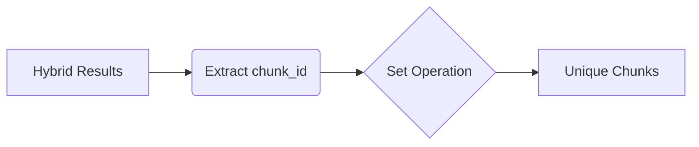

# Design Decisions & Trade-offs

This document details *why* EnterpriseIQ is built the way it is.

## 1. Extractive over Generative Default

By default, the `GroundedAnswerGenerator` operates in "Extractive Mode".

**Trade-off:** We sacrifice conversational fluidity to mathematically guarantee zero hallucinations. In a highly regulated enterprise, an exact snippet citation is vastly preferred over a smoothly synthesized (but potentially flawed) summary.

## 2. Strict ID-Based Deduplication

We do not rely on Python's memory addresses (`id()`) or object hashing for dataclasses representing chunks. We explicitly use the `chunk_id`. This prevents subtle deduplication errors when candidates surface from both ChromaDB and BM25 simultaneously.

## 3. Pre-Filter vs Post-Filter RBAC

We enforce RBAC at the vector DB level (pre-filter) *and* at the context assembly level (post-filter). This redundancy ensures that even if a search index is corrupted or manipulated, the application layer will catch and reject unauthorized data before it reaches the generator.
