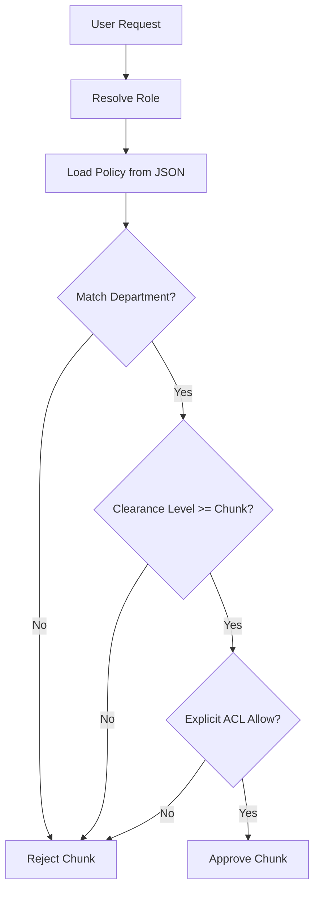

# Internals

This section covers the internal operations of the EnterpriseIQ platform.

## The RBAC Engine

The `RBACEngine` is the core security component. It reads policies from `data/rbac/access_policies.json`.

## Hybrid Fusion Algorithm

We use a Min-Max normalized Reciprocal Rank Fusion algorithm to combine Dense and Sparse scores.

$Score_{final} = (\alpha \times Score_{dense}) + ((1 - \alpha) \times Score_{sparse})$

Where $\alpha$ is defined by `HYBRID_ALPHA` in the configuration.
