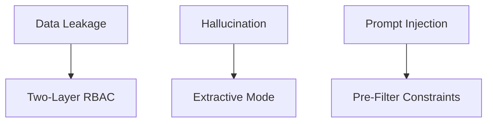

# Security Details

Security is not an afterthought in EnterpriseIQ; it is the core value proposition.

## Threat Vectors & Mitigation

1. **Pre-Filter (Vector DB):** ChromaDB metadata filters drop unauthorized chunks before they are even retrieved.
2. **Post-Filter (Python):** Python `if` statements explicitly check the ACL of every retrieved chunk against the user's role.
3. **No Generation Guesswork:** The default generator only yields strings explicitly found in the authorized context.
